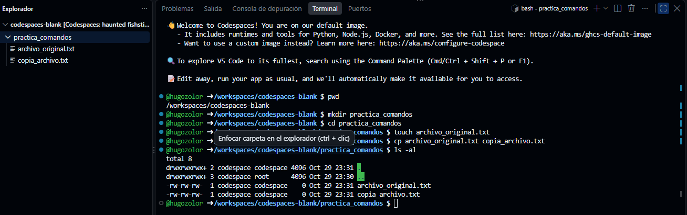
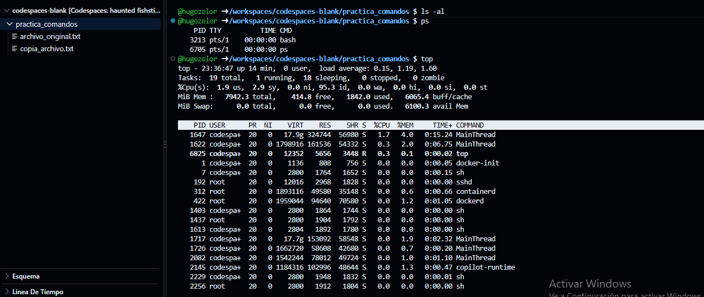
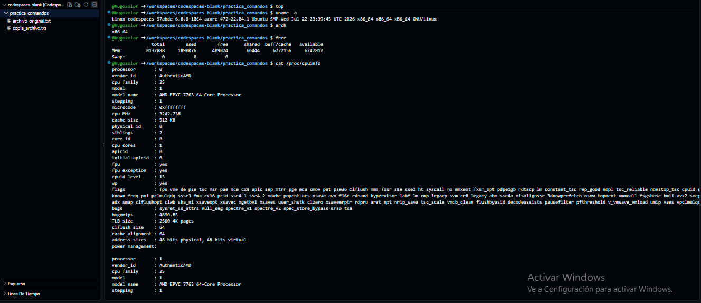
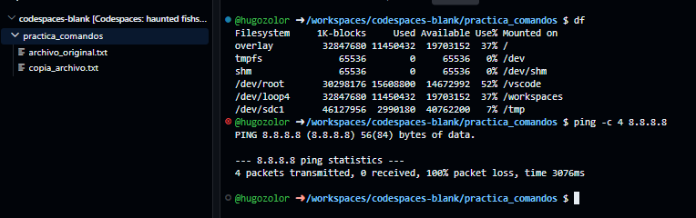

# TP: Comandos Básicos, Procesos y Utilidades en Linux

* **Materia:** Mantenimiento de Software
* **Estudiante:** Zolorza Choque Hugo Juan José
* **Fecha de Entrega:** 2026
* **Profesor:** Gabriel Artaza

---

## 1. Gestión de Archivos y Directorios

* **Explicación de `ls -al`:** A diferencia del comando `ls` simple, que únicamente muestra los nombres de los archivos y carpetas visibles en formato columnar reducido, la combinación `-al` agrega dos funciones clave:
  - `-a` (*all*): Muestra absolutamente todos los archivos y directorios, incluidos los archivos ocultos (cuyo nombre empieza con un punto `.`, así como los directorios especial `.` y `..`).
  - `-l` (*long*): Muestra la información en formato de lista detallada, exponiendo los permisos de acceso, número de enlaces, usuario propietario, grupo, tamaño en bytes y fecha/hora de última modificación.

---

## 2. Monitoreo de Procesos

* **Diferencia entre `ps` y `top`:** El comando `ps` (sin opciones) toma una "fotografía" o captura estática y puntual de los procesos que pertenecen únicamente a la sesión de terminal actual en ese instante. En cambio, `top` es una herramienta interactiva y dinámica que se ejecuta en tiempo real, actualizando la lista de todos los procesos del sistema cada pocos segundos y ordenándolos según el consumo de recursos (CPU, memoria RAM).
* **Uso de `kill`:** El comando `kill pid` se utiliza para enviar una señal de terminación al sistema operativo dirigida a un proceso específico identificado por su número de proceso (`PID`). En caso de que un programa se quede colgado o no responda, permite cerrarlo (por defecto mediante la señal SIGTERM, o forzosamente con `kill -9 <PID>` mediante SIGKILL) para liberar los recursos del sistema.

---

## 3. Información del Sistema

* **Detalles del Kernel y Memoria:**
  - `uname -a`: Aporta información completa sobre el núcleo (kernel) del sistema operativo, indicando el nombre del kernel (Linux), el nombre de red de la máquina (hostname), la versión exacta y fecha de compilación del kernel, la arquitectura del hardware (por ejemplo `x86_64`) y el tipo de sistema operativo.
  - `free`: Muestra un resumen del estado de la memoria física (RAM) y de la memoria de intercambio (*swap*) del equipo, detallando la cantidad total de memoria, la que está actualmente en uso, la que se encuentra libre y la memoria disponible para nuevos procesos.

---

## 4. Red y Espacio en Disco

* **Funcionamiento de `ping`:** El objetivo principal de utilizar `ping` en una red TCP/IP es verificar la conectividad de red y alcanzabilidad de un host remoto (usando paquetes de solicitud y respuesta de eco del protocolo ICMP). Permite diagnosticar si el destino está accesible, medir el tiempo de ida y vuelta que tardan los datos en viajar (latencia) y verificar si existe pérdida de paquetes en la transmisión.
