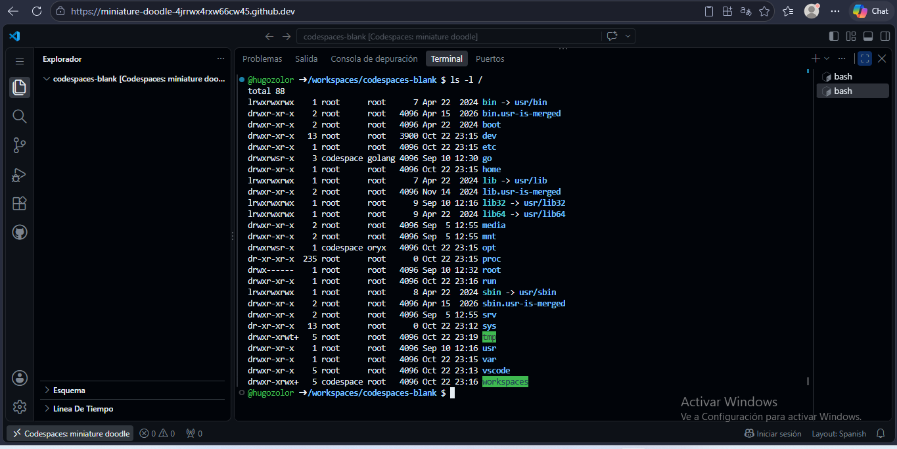
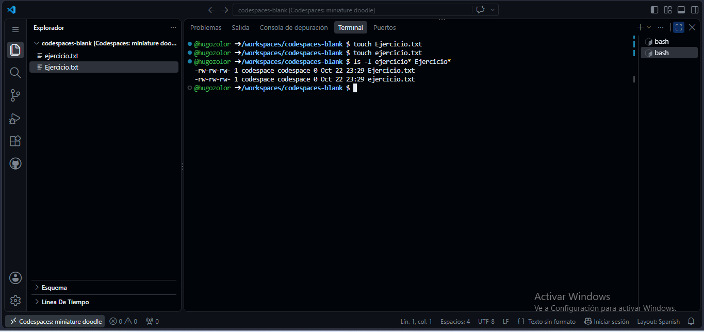
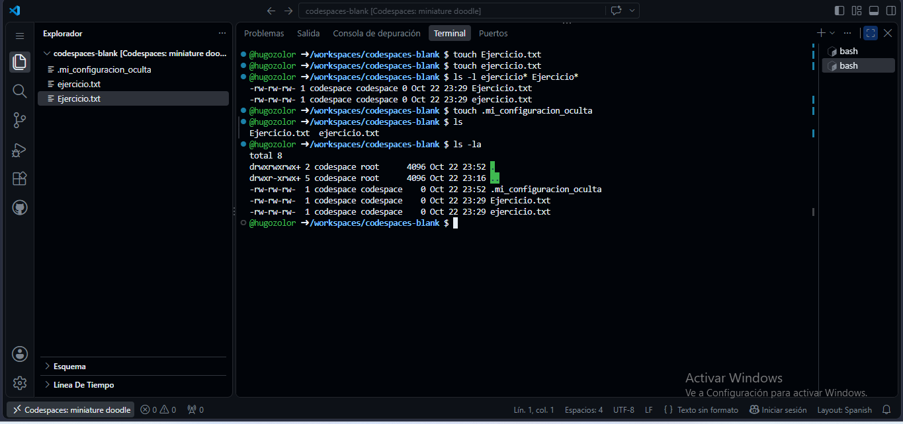
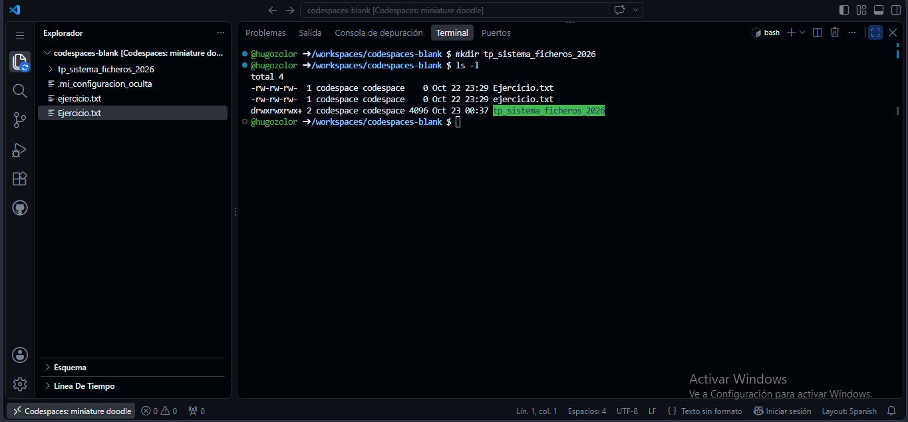
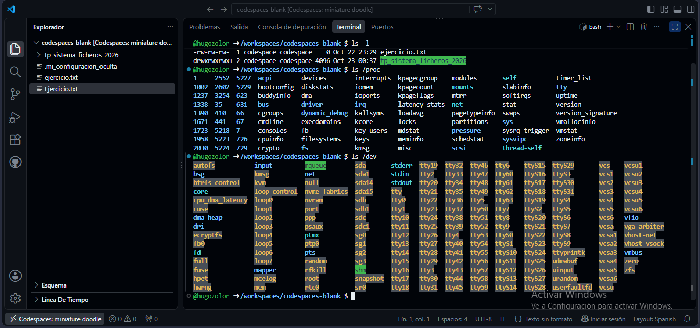

# TP: Sistema de Archivos en Linux

* **Materia:** Mantenimiento de Software
* **Estudiante:** Zolorza Choque Hugo Juan José
* **Fecha de Entrega:** 22/10/2026
* **Profesor:** Gabriel Artaza

---

## 1. Estructura del Árbol de Directorios

| Directorio | Función según la guía |
| :--- | :--- |
| `/etc` | Archivos de configuración de la mayoría de los programas. |
| `/home` | Archivos personales de los usuarios. |
| `/dev` | Archivos simbólicos que representan hardware. |
| `/var` | Datos variables como registros (logs) y bases de datos. |

---

## 2. Sensibilidad a Mayúsculas y Minúsculas

*Respuesta:* En Linux es posible tener `Ejercicio.txt` y `ejercicio.txt` en la misma carpeta porque su sistema de archivos (como `ext4`) es **Case Sensitive** (sensible a mayúsculas y minúsculas). Internamente, el sistema distingue el código binario de la letra `E` mayúscula del de la `e` minúscula, tratándolos como dos archivos totalmente independientes, a diferencia de Windows (NTFS por defecto), que es *Case Insensitive* y los considera el mismo nombre.

---

## 3. Visualización y Gestión de Archivos Ocultos

*Respuesta:* La utilidad principal de los archivos ocultos en Linux (los que comienzan con un punto `.`) es almacenar archivos de configuración del sistema y de las aplicaciones del usuario (como `.bashrc`, `.profile` o `.gitconfig`) sin saturar visualmente el directorio de trabajo cotidiano, evitando además que el usuario los modifique o elimine por accidente.

---

## 4. Buenas Prácticas en Nombres de Archivos

*Respuesta:* El nombre `tp_sistema_ficheros_2026` cumple con las recomendaciones porque utiliza únicamente caracteres alfanuméricos en minúscula y guiones bajos (`_`) en lugar de espacios. En cambio, `TP Sistema de Ficheros (Año 2026)!.doc` no cumple las buenas prácticas porque incluye espacios en blanco (que la terminal interpreta como separadores de argumentos), caracteres especiales reservados por la shell como paréntesis `()` y signo de exclamación `!`, y caracteres no estándar como la `ñ`, lo que dificulta su manipulación por línea de comandos y scripts.

---

## 5. Exploración de Dispositivos y Procesos

*Respuesta:* El directorio `/proc` almacena un sistema de archivos virtual generado en tiempo real en memoria que contiene información sobre los procesos en ejecución (identificados por su PID) y el estado interno del kernel y del hardware del sistema (como uso de memoria en `/proc/meminfo` o procesador en `/proc/cpuinfo`).
